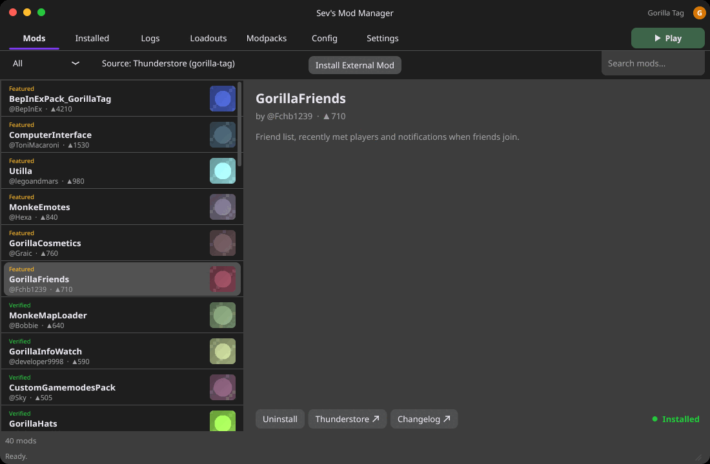
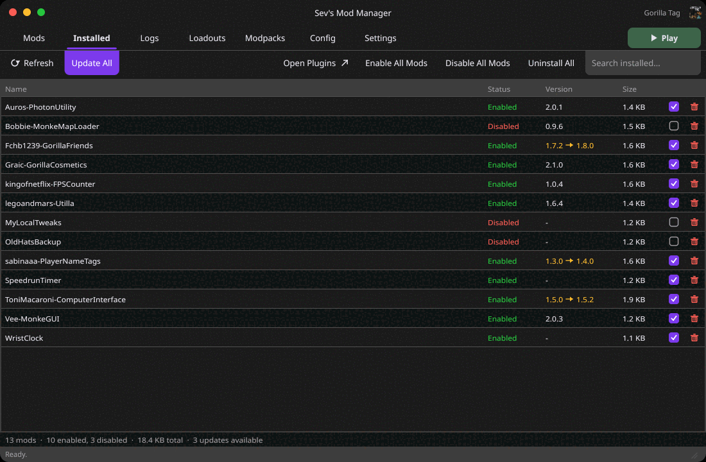
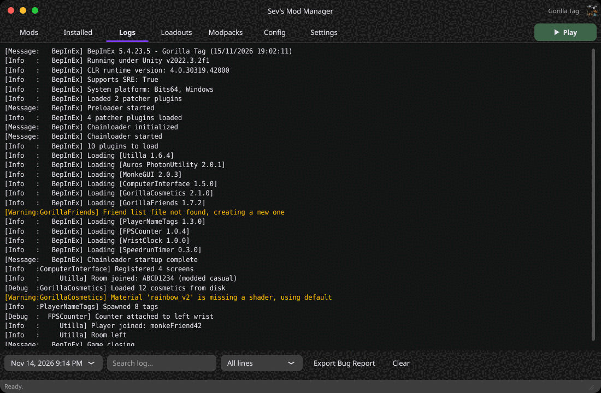
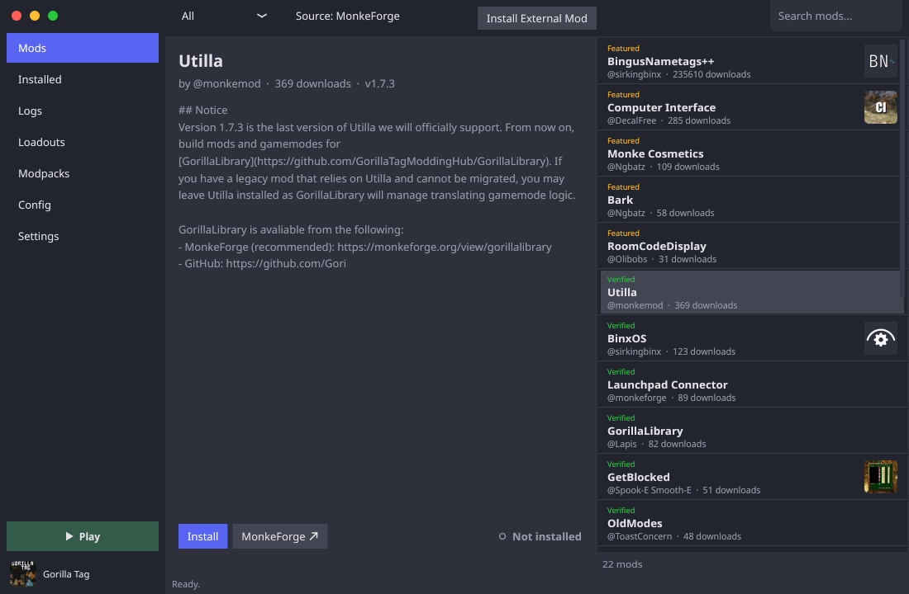
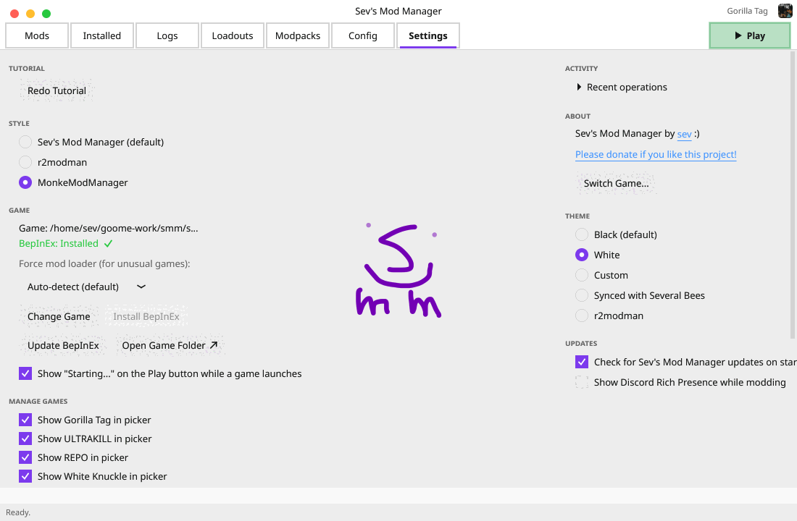
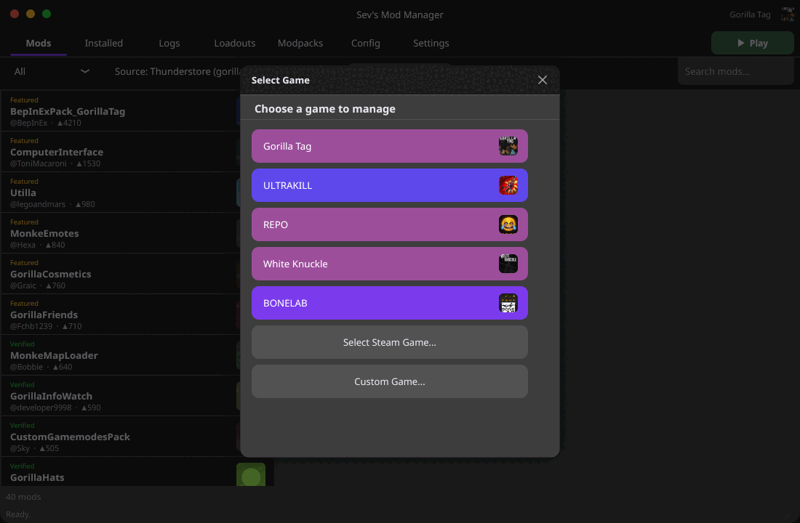
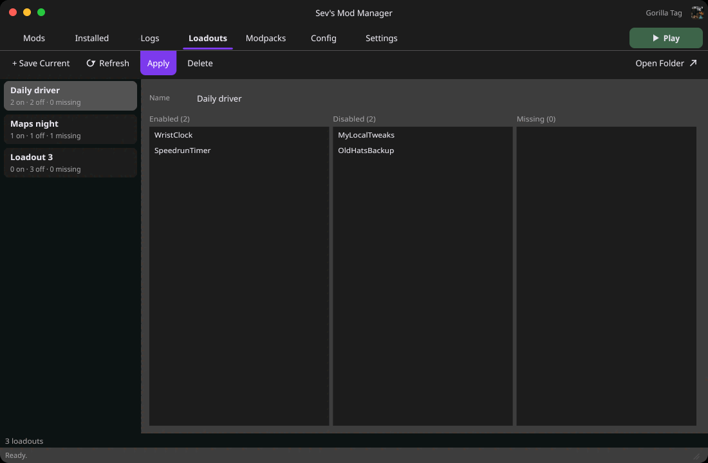

<h1 align="center">🐒 Sevs Mod Manager 🐒</h1>

<p align="center">
<b>I made this because i hate every other one. This mod manager one does Gorilla Tag, ULTRAKILL, REPO, White Knuckle, BONELAB and anything else made in unity, on Linux, Windows and Mac.<br>
Add your own mods to the SB/SMM library at <a href=https://sevvy-wevvy.com/mods/sb/dashboard/>sevvy-wevvy.com/mods/sb/dashboard</a>!<br><br>
Do you like this project? If so, please let me know! <a href="https://sevvy-wevvy.com/discord">Discord</a>
</p>

<div align="center">
 
</div><br>

<p align="center">
  <a href="https://github.com/sevvy-wevvy/sevs-mod-manager/releases">
    
  </a>
  <a href="https://sevvy-wevvy.com/discord">
    
  </a>
  <a href="https://github.com/goome-ui"></a>
  <a href="https://sevvy-wevvy.com/donate" target="_blank">
    
  </a>
</p>

<details open>
<summary align="center"><b>⬇️ Easy Install ⬇️</b></summary>

<h3 align="center">🐧 Linux &nbsp;·&nbsp; 🍎 Mac</h3>

```sh
curl -fsSL https://raw.githubusercontent.com/sevvy-wevvy/sevs-mod-manager/dev/install.sh | sh
```

<h3 align="center">🪟 Windows (PowerShell, not cmd)</h3>

```powershell
irm https://raw.githubusercontent.com/sevvy-wevvy/sevs-mod-manager/dev/install.ps1 | iex
```

<h3 align="center">🏹 Arch Linux</h3>

<p align="center">The Linux line works on Arch too. If you want pacman to own it, build the package from source:</p>

```sh
mkdir smm && cd smm && curl -fsSLO https://raw.githubusercontent.com/sevvy-wevvy/sevs-mod-manager/dev/packaging/PKGBUILD && makepkg -si
```

<p align="center">
Run the same line again any time to update.<br>
Linux and Mac put it in <code>~/.local/bin/smm</code>, Windows in <code>%LOCALAPPDATA%\SevsModManager</code> with a start menu entry.<br>
It needs <code>curl</code>, which Windows 10+, Mac and nearly every Linux already have. <code>zenity</code> or <code>kdialog</code> gives you file pickers on Linux.<br>
Windows might show a SmartScreen warning because the exe isnt signed, click More info then Run anyway.
</p>

</details>

<details>
<summary align="center"><b>📸 Screenshots 📸</b></summary>

<p align="center">

<br>

<br>


</p>

<p align="center">Installed, Logs, the r2modman and MonkeModManager layouts, the game picker and Loadouts. You can switch layout and theme in Settings and it changes instantly.</p>

</details>

<details>
<summary align="center"><b>📃 Features 📃</b></summary>

<p align="center">
<b>Mods</b><br>
Browse and download mods from Thunderstore<br>
Browse, download, and upvote mods from the official SB API<br>
Gorilla Tag also gets <a href="https://monkeforge.org">MonkeForge</a>, and every download is checked against its SHA-256<br>
Search and filter mods (All / Featured / Verified / Unverified)<br>
Warns before installing unverified mods<br>
Auto-installs a mods dependencies and the right mod loader (BepInEx or MelonLoader)<br>
Install your own DLLs, or drag and drop them onto the window<br><br>

<b>Installed</b><br>
Enable, disable, update and delete mods, or update everything in one click<br>
Conflict detection when two mods ship the same file<br><br>

<b>Loadouts, Modpacks and Config</b><br>
Save and swap loadouts, share modpacks as <code>.smmpack</code> files<br>
Edit BepInEx and MelonLoader configs right in the app<br><br>

<b>Logs</b><br>
Live game log, your last 10 sessions, search and filters<br>
"Possible culprit" banner when a mod crashes your game<br><br>

<b>Games</b><br>
Finds your Steam games on every OS, Proton included, and switches between them in one click<br>
Shows each games own icon<br>
Three layouts (Sev's Mod Manager, r2modman and MonkeModManager style) and five themes, all switch live<br>
</p>

</details>

<details>
<summary align="center"><b>🛠️ Build It Yourself 🛠️</b></summary>

<p align="center">You only need a C compiler. The whole thing is C99 on <a href="https://github.com/goome-ui/c-goome">goome</a>, no other libraries.</p>

```sh
git clone -b dev https://github.com/sevvy-wevvy/sevs-mod-manager
cd sevs-mod-manager
./build.sh
./build/smm
```

<p align="center">
<code>./build.sh test</code> runs the tests, <code>./build.sh win</code> makes the Windows exe with mingw.<br>
<code>SMM_DEMO=1 ./build/smm</code> opens it with fake games and mods and no network, handy for trying it out.
</p>

</details>

<details>
<summary align="center"><b>🛠 Pull Requests 🛠</b></summary>

<p align="center">
Want to help with this project? Make A pull request!<br>
Pull request allow for anyone to request a change to this code. In turn meaning that <b>YOU</b> can contribute to this project.<br>
As long as it works, and doesnt vary off too far from the main idea its very likely it get accepted!
</p>

</details>

<details>
<summary align="center"><b>⚖️ License ⚖️</b></summary>

<p align="center">
This project is licensed under the <b>GPL-3.0</b>.<br>
<sub>
• You can use, change and share it<br>
• If you share a changed version it has to stay GPL-3.0 and open source<br>
• Keep the original credit
</sub><br><br>
In short: play fair, keep it open, and give credit where it's due.
</p>

</details>

<details>
<summary align="center"><b>🩷 Donate 🩷</b></summary>

<p align="center">
Ko-fi (Preferred): <a href="https://sevvy-wevvy.com/kofi">sevvy-wevvy.com/kofi</a><br>
Patreon: <a href="https://sevvy-wevvy.com/patreon">sevvy-wevvy.com/patreon</a><br>
Throne: <a href="https://sevvy-wevvy.com/throne">sevvy-wevvy.com/throne</a>
</p>

</details>

<p align="center">
This is a full rewrite of the old C# app, in C. Discord rich presence didnt make it over, and the old C# code is still in the git history before the rewrite.
</p>
